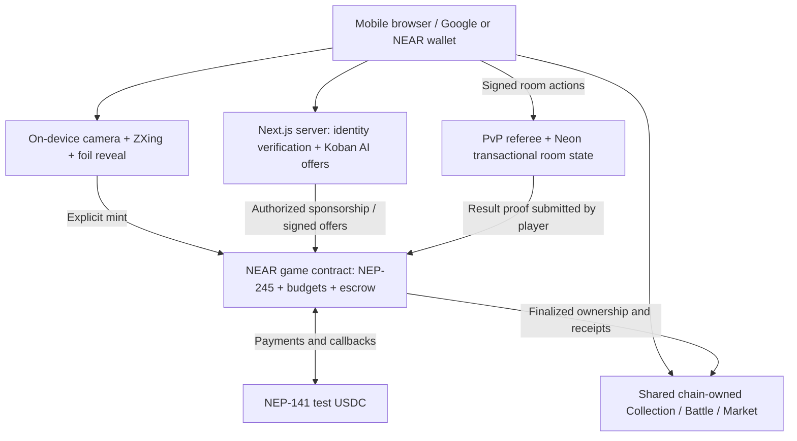

<div align="center">
  

# scanMon

**Scan the everyday. Collect the unexpected. Play for keeps.**

A mobile browser game where product barcodes become collectible monsters, NPCs trade from real budgets, and players battle with cards they own on NEAR.

[](https://testnet.nearblocks.io/address/scanmon-6f49a2b600.testnet)
[](https://github.com/nearai/near-hackathon-prompt-examples/blob/main/tracks/09-games.md)
[](smartcontract/game/src/lib.rs)

[Play scanMon](https://scannmon.vercel.app) · [Judge walkthrough](#judge-walkthrough) · [PvP](#3-vs-3-pvp--stake-a-card-win-a-card) · [On-chain proof](#on-chain-proof) · [Run locally](#installation--setup)

</div>

## Project overview

### The problem

Collectible games need a reason to discover, a reason to keep an item, and a reason to trade it. Blockchain ownership alone does not create that loop. Unlimited NPC rewards and fixed merchant prices also make an economy feel disconnected from player decisions.

### Our approach

scanMon starts with an object already on the player's desk. Scan its barcode, peel open a foil mystery sticker, and reveal a monster. Keep the card for a three-card battle team, trade it with Koban, list it for another player, or stake it in PvP.

The economy connects those choices: **cards are owned items, merchant stock changes through trades, rewards draw from a shared funded pool, and PvP transfers existing cards between players.** These are NEAR testnet transactions with inspectable receipts.

| Experience                  | Implemented behavior                                                                                                                                                                           |
| --------------------------- | ---------------------------------------------------------------------------------------------------------------------------------------------------------------------------------------------- |
| **Scan → peel → reveal**    | Rear-camera EAN/UPC decoding, checksum validation, starfall animation, draggable or tappable foil peel, and matching animated character/card artwork over the live camera.                     |
| **Persistent discoveries**  | A canonical barcode maps to the same species in season v1. The contract permits one discovery per account/barcode/season; retries cannot mint extra copies.                                    |
| **Player-owned Collection** | NEP-245 card instances shared across Collection, Battle and Market; ownership refreshes after finalized mint, trade or PvP settlement.                                                         |
| **Tomo companion**          | Three contract-verified milestones: first discovery, three distinct discoveries, and first battle victory. Claims and the one-time 25 test-USDC starter grant debit Tomo's shared finite pool. |
| **Koban merchant**          | Buy and sell existing cards, inspect stock-dependent contract quotes, or negotiate through an AI conversation with expiring signed offers. Sales consume Koban's funded budget.                |
| **Player marketplace**      | List owned cards, cancel listings, buy escrowed cards, and withdraw seller proceeds in the configured NEP-141 token.                                                                           |
| **Daily Boss**              | Play a three-card raid without a transaction for each attack; explicitly claim a first-clear boss collectible after the contract verifies the battle transcript.                               |
| **Staked-NFT PvP**          | Two players escrow one card each, fight a synchronized 3-vs-3 auto-battle, then settle the winner's claim or return the stakes on a refund outcome.                                            |
| **Social onboarding**       | Google sign-in through Privy, an embedded NEAR wallet, and a one-time sponsored activation grant. HERE, Meteor and MyNearWallet are also supported.                                            |

**Network and currency:** this MVP runs on **NEAR testnet**. The interface labels its currency USDC; the deployed token is **USDC.mock**, a six-decimal NEP-141 test token, not Circle-issued USDC and not redeemable money. Native test NEAR pays gas and storage.

## Games With Real Economies: track alignment

Built for [Track 09 — Games With Real Economies](https://github.com/nearai/near-hackathon-prompt-examples/blob/main/tracks/09-games.md), whose focus is an economy shaped by player activity and NPCs with wallets.

| Track requirement                    | scanMon implementation and evidence                                                                                                                                                                                                                                                                                    |
| ------------------------------------ | ---------------------------------------------------------------------------------------------------------------------------------------------------------------------------------------------------------------------------------------------------------------------------------------------------------------------- |
| **A compelling game loop**           | Barcode discovery feeds collection, team building, merchant supply, player trading and PvP stakes. See the session loop below.                                                                                                                                                                                         |
| **NEP-245 items**                    | One Rust game contract holds card instances and implements multi-token ownership/transfer methods. [Contract source](smartcontract/game/src/lib.rs).                                                                                                                                                                   |
| **NPC wallets and inventory**        | Tomo and Koban have distinct NEAR accounts and separate funded credits inside the game contract. Rewards and merchant purchases draw from those credits. [Public accounts](#deployed-accounts).                                                                                                                        |
| **Prices respond to the economy**    | The readable `price()` function accounts for species, merchant stock and a configured Electric-demand factor; player trades alter stock. [Pricing implementation](smartcontract/game/src/lib.rs). The current demand factor is a game rule, not an adaptive demand forecast.                                           |
| **Merchant reasoning**               | Koban's conversation explains offers and supports counteroffers; the server signs an expiring offer bound to card, direction, amount and offer ID. [Negotiation service](src/app/api/market/negotiate/route.ts).                                                                                                       |
| **Social login / low-friction play** | Google users receive an embedded wallet and sponsored activation without setting up a seed phrase. Camera discovery and combat do not require per-frame or per-attack transactions. Explicit mint, escrow, claim and trade actions still require signing. [Wallet integration](src/components/near/privy-runtime.tsx). |
| **A week of trading in one minute**  | **Not implemented.** Economy fast-forward remains a PRD item; this repository demonstrates live testnet trading instead.                                                                                                                                                                                               |

NEAR Intents is not integrated. The MVP uses direct NEAR contract calls and NEP-141 settlement. Tomo's current quests are fixed, contract-verified rules; Koban is the generative AI merchant. This distinction keeps the implemented agent behavior clear.

### The session loop

| Rhythm               | Player action                                                                                  | Effect on the game economy                                                                                               |
| -------------------- | ---------------------------------------------------------------------------------------------- | ------------------------------------------------------------------------------------------------------------------------ |
| **About 30 seconds** | Scan a new product, peel the sticker, inspect the reveal and choose whether to mint.           | A validated discovery can become a uniquely owned card; repeating the same barcode does not farm additional discoveries. |
| **About 5 minutes**  | Assemble three cards, fight the boss, negotiate a trade, or challenge another player.          | Cards gain playable utility; trades change inventory; PvP puts existing ownership at stake.                              |
| **Each session**     | Check Tomo's tasks, the merchant's inventory and player listings; decide what to keep or sell. | Claims consume finite rewards, sales replenish merchant stock, and purchases move cards into player teams.               |

## Judge walkthrough

**Start at [scannmon.vercel.app](https://scannmon.vercel.app) on a phone over HTTPS.** Use two distinct accounts/browser sessions for player-to-player trading or PvP. Each PvP participant needs three eligible owned cards.

1. **Connect.** Open Settings → Account and sign in with Google, or connect a supported NEAR wallet. Google activation receives 0.5 test NEAR once per identity/account, subject to the finite sponsor balance. Signing waits until the wallet's access key exists on-chain.
2. **Discover.** Allow the camera and scan an everyday product barcode. Tap reveal, watch the starfall, then drag or tap the mystery sticker's curled corner. The printed product barcode appears on the mystery card. Mint explicitly and verify the result in Collection.
3. **Check consistency.** Scan the same product again: its species stays the same and the contract prevents a second discovery mint. Scan different products to collect three distinct discoveries and build a team. Species can repeat across different products.
4. **Meet Tomo.** Open the companion's Tasks and About tabs. Claim an eligible task and inspect its receipt. In Settings, the one-time 25 test-USDC starter grant also draws from Tomo's global pool, rather than creating a private balance for every viewer.
5. **Trade.** Open Market, choose a card, and negotiate with Koban or use an available quote. Complete a buy or sale and inspect the corresponding inventory/ownership change. With a second account, list → buy → withdraw demonstrates player settlement.
6. **Fight the boss.** Open Battle, choose three eligible cards, start the Daily Boss and attack. After victory, peel the reward and press Claim boss card. The contract replays the bounded transcript before minting the first-clear reward.
7. **Try PvP.** Open Battle → Find Match. Set a username, select three owned cards and stake one. Create a room; have the second player join by room code or username with their own team/stake. Both press Attack. After the result, submit Claim to settle ownership.
8. **Inspect proof.** Settings → History links transactions to NEAR Explorer. Collection, Battle and Market use the refreshed chain-owned inventory after finality.

For a prepared camera fixture, valid barcode values include `4006381333931`, `036000291452`, and `9780201379624`. Present them as **printed/scannable EAN/UPC barcodes**; these are not a manual-entry UI or guaranteed unique-species set. Camera frames are decoded on-device and are not uploaded by the scanning flow.

## 3-vs-3 PvP — stake a card, win a card

PvP adds a direct economic choice: **risk one collectible to win the opponent's staked collectible.** Winning transfers existing NFTs; it does not print another reward supply.

- **Entry and custody:** each player chooses three eligible owned card instances and one stake from that team. `create_pvp` / `join_pvp` put the stakes in contract escrow and lock the remaining team cards against incompatible trades or battles.
- **Synchronized combat:** both players press Attack to start a fixed 90-second server deadline. Living fighters attack simultaneously on timed ticks using per-character HP and ATK ÷ 10. Repeated polling cannot add attacks or restart the clock.
- **Action authorization:** a browser-generated, room-scoped Ed25519 session key signs combat requests. It cannot sign arbitrary wallet transactions. Session private keys remain in that browser's storage.
- **Settlement:** the server referee signs a result proof; the contract verifies its domain, room, participant, winner, expiry and terminal state. The winner explicitly claims both stakes. Repeated settlement cannot transfer them twice.
- **Recovery:** draws, double knockouts, combat timeout and qualifying disconnects produce refund proofs. An unjoined room can be cancelled; a 24-hour on-chain expiry permits recovery if the backend is unavailable. A player must submit the recovery transaction; refunds are not automatic background payments.

**Trust model:** PvP combat is server-authoritative, backed by Neon PostgreSQL row locks and a trusted signing referee. It is not trustless on-chain combat. NEAR enforces escrow and verifies the configured referee's signed settlement proof. The current testnet referee uses the dedicated sponsor signing key; that key is consequently security-critical beyond gas funding.

[Combat engine](src/lib/pvp/engine.ts) · [Room server](src/lib/pvp/server.ts) · [PvP integration and recovery details](src/app/battle/pvp/INTEGRATION.md) · [Recorded live validation](smartcontract/deployments/pvp-validation.json)

## Blockchain relevance & economy boundaries

NEAR is the ownership and settlement layer. It determines whether a card belongs to a player, whether it is escrowed or locked, whether a claim was already consumed, and whether an authorized payment can complete. Animations alone never grant ownership.

| Flow                             | Authoritative behavior                                                                                                                                                                            |
| -------------------------------- | ------------------------------------------------------------------------------------------------------------------------------------------------------------------------------------------------- |
| **Discovery**                    | Barcode checksum/canonicalization and season-specific mapping; one discovery per account and canonical barcode. A barcode identifies a product type, not proof of purchase or physical ownership. |
| **Tomo rewards**                 | Contract-checked eligibility, one-time claims, reserved budget during payment, and restoration on payout failure. The starter grant and task rewards share the global pool.                       |
| **Koban trading**                | Stock-dependent base quotes or authorized signed negotiated offers; merchant inventory and finite buying budget constrain settlement. AI dialogue does not itself transfer funds.                 |
| **Player sales**                 | Escrowed items; NEP-141 payment transfers the item and backs seller credit. Withdrawals move that credit into the seller's token wallet.                                                          |
| **Failed asynchronous payments** | Settlement callbacks restore reserved funds or inventory when required. Failed or unresolved receipts are not presented as completed trades.                                                      |
| **Boss claims**                  | Three owned cards and a valid winning transcript are checked on-chain. The first-clear collectible is idempotent.                                                                                 |
| **PvP claims**                   | Existing escrowed stakes move only after an accepted signed proof or recovery path.                                                                                                               |

Tomo and Koban's balances are shared across players, not generated separately in local storage. Their initial allocations were finite test-token deposits. New player subsidies reduce available reserves; selling to Koban uses its buying budget, while buying from Koban adds merchant credit. Neither test-token rewards nor testnet liquidity represent sustainable real-world revenue or a promise of returns.

### Deployed accounts

All addresses below are **existing NEAR testnet accounts**. Running the frontend does not deploy or upgrade a contract.

| Account           | Address / Explorer                                                                                               | Role                                                                                                        |
| ----------------- | ---------------------------------------------------------------------------------------------------------------- | ----------------------------------------------------------------------------------------------------------- |
| Game              | [`scanmon-6f49a2b600.testnet`](https://testnet.nearblocks.io/address/scanmon-6f49a2b600.testnet)                 | NEP-245 items, discoveries, rewards, merchant trading, player listings, boss claims and PvP escrow.         |
| Test USDC         | [`usdc.scanmon-6f49a2b600.testnet`](https://testnet.nearblocks.io/address/usdc.scanmon-6f49a2b600.testnet)       | Six-decimal mock NEP-141 settlement token.                                                                  |
| Tomo              | [`tomo.scanmon-6f49a2b600.testnet`](https://testnet.nearblocks.io/address/tomo.scanmon-6f49a2b600.testnet)       | Companion funding account; its reserved budget is accounted for in the game contract.                       |
| Koban             | [`koban.scanmon-6f49a2b600.testnet`](https://testnet.nearblocks.io/address/koban.scanmon-6f49a2b600.testnet)     | Merchant funding account and configured offer signer; shop custody/budget are managed by the game contract. |
| Sponsor / referee | [`sponsor.scanmon-6f49a2b600.testnet`](https://testnet.nearblocks.io/address/sponsor.scanmon-6f49a2b600.testnet) | Finite Google activation funding and configured PvP result signing.                                         |

### On-chain proof

These are recorded testnet receipts, not simulated UI events. Historical receipts demonstrate specific validated flows; they are not a claim that every current UI interaction has been tested on every device.

| Verified flow                                            | Transaction                                                                                     | Supporting record                                                                                       |
| -------------------------------------------------------- | ----------------------------------------------------------------------------------------------- | ------------------------------------------------------------------------------------------------------- |
| Card discovery mint                                      | [View receipt](https://testnet.nearblocks.io/txns/6trjD2PF6JrDwQAqMTihTirWyypSsgSeh1v7X63UTZy5) | [Integration validation](smartcontract/deployments/testnet-validation.json)                             |
| Starter grant debits Tomo's pool; token supply unchanged | [View receipt](https://testnet.nearblocks.io/txns/6E9MyhuiLEyRiaskq8Ks7o4LPR6qW4CAYHtxyvqxnxda) | [Before/after balances and duplicate rejection](smartcontract/deployments/starter-pool-validation.json) |
| Two-account player purchase                              | [View receipt](https://testnet.nearblocks.io/txns/DVPJnkK7G33eATRmnbbr6EdNufQhqSgF751rSj2hffMf) | [Trade, escrow and withdrawal checks](smartcontract/deployments/testnet-validation.json)                |
| Failed payout restores the reserved pool                 | [View receipt](https://testnet.nearblocks.io/txns/GMUaEsRCimZgkkch9aFdray8z28Qn5UM1FdcauFMnwML) | [Callback failure/recovery validation](smartcontract/deployments/testnet-callback-validation.json)      |
| PvP stake escrow                                         | [View receipt](https://testnet.nearblocks.io/txns/CZ5NFWiotXYDMiJGyEwZk88JZPgjBquwvF86iXnsp3Cn) | [Two-wallet PvP validation](smartcontract/deployments/pvp-validation.json)                              |
| PvP winner settlement                                    | [View receipt](https://testnet.nearblocks.io/txns/8LfvETqdtoBVqEBhn3mTPZ4LYFRzrNu76SaH1p3r2Kpn) | [Winner, retry, disconnect and timeout checks](smartcontract/deployments/pvp-validation.json)           |

## Technical architecture



| Layer             | Stack                                                        | Responsibility                                                                            |
| ----------------- | ------------------------------------------------------------ | ----------------------------------------------------------------------------------------- |
| App               | Next.js App Router, React, TypeScript                        | Mobile-first shell, scan/reveal, inventory, market, boss and PvP screens.                 |
| Capture & motion  | Browser MediaDevices, ZXing, Motion, supplied PNG/GIF assets | Real barcode decoding, foil interaction, animated characters and reduced-motion behavior. |
| Wallets           | Privy extended-chain NEAR signing; NEAR Wallet Selector      | Google embedded wallets and external NEAR wallet connections.                             |
| Contracts         | Rust, near-sdk, NEP-245 and NEP-141                          | Ownership, escrow, claims, trade settlement and bounded agent budgets.                    |
| AI merchant       | Gemini with DeepSeek fallback; server-side offer signing     | Streamed Koban conversation and explicit, expiring negotiated offers.                     |
| PvP backend       | Next.js Route Handler, Neon PostgreSQL, Ed25519 proofs       | Atomic room updates, synchronized combat and authorized settlement results.               |
| Hosting & history | Vercel, NEAR RPC, NearBlocks                                 | Web hosting, contract reads/writes and Explorer-linked history.                           |

### Repository structure

```text
src/app/scan/                  Camera discovery route
src/app/collection/            Card catalog and owned-card interface
src/app/market/                Merchant and player marketplace
src/app/battle/                Daily Boss, team selection and PvP screens
src/app/api/                   Sponsorship, negotiation, history and PvP endpoints
src/components/near/           Shared wallet runtime, Settings and transaction proofs
src/components/scan-reveal.tsx Foil peel and explicit discovery mint
src/components/tomo-companion.tsx
src/lib/near/                  Shared chain store, adapters, RPC and wallet activation
src/lib/pvp/                   Session protocol, combat engine and referee server
smartcontract/game/            Rust game contract and contract tests
smartcontract/mock-usdc/       Test settlement token
smartcontract/deployments/     Existing deployment manifests and public validation receipts
scripts/pvp-schema.sql        PvP database schema
public/assets/                Logo, cards, character animation and UI artwork
docs/                         Implementation and validation notes
```

## Installation & setup

### Requirements

- Node.js **22 or newer** and npm.
- A modern browser. Phone camera access requires **HTTPS**; desktop `localhost` is suitable for local development.
- Your own Privy credentials for Google login; a funded testnet sponsor for activation.
- Neon PostgreSQL and a configured referee for the complete PvP backend.
- Rust is optional for reading, testing or building contract source. It is not required to run the frontend against the existing deployment.

### Run the app

```bash
git clone https://github.com/rikokurnia/scanmon.git
cd scanmon
npm ci
cp .env.example .env.local
```

Fill the necessary credentials in `.env.local`; the public testnet contract IDs are provided in the template. Then start the app:

```bash
npm run dev
```

Open `http://localhost:3000`. Start with the hosted demo if you only want to play.

| Configuration                                                                                                          | Needed for                                                                                                                                             |
| ---------------------------------------------------------------------------------------------------------------------- | ------------------------------------------------------------------------------------------------------------------------------------------------------ |
| `NEXT_PUBLIC_NEAR_CONTRACT_ID`, `NEXT_PUBLIC_USDC_CONTRACT_ID`, `NEXT_PUBLIC_NEAR_RPC_URL`, `NEXT_PUBLIC_USDC_IS_MOCK` | Existing NEAR testnet contracts and RPC. Public values may reach the browser.                                                                          |
| `APP_ID_PRIVY`, `APP_SECRET_PRIVY`                                                                                     | Google authentication; only the app ID is browser-visible.                                                                                             |
| `NEAR_SPONSOR_ACCOUNT_ID`, `NEAR_SPONSOR_PRIVATE_KEY`                                                                  | Server-only activation funding and the currently configured PvP referee. The signer must match the existing on-chain configuration.                    |
| `PVP_DATABASE_URL`                                                                                                     | Server-only Neon PostgreSQL connection; initialize its schema using `scripts/pvp-schema.sql`.                                                          |
| `GEMINI_API_KEY` and/or `DEEPSEEK_API_KEY`                                                                             | Koban's AI dialogue.                                                                                                                                   |
| `NEAR_KOBAN_PRIVATE_KEY`                                                                                               | Server-side negotiated-offer signing, matching the configured Koban public key. Keep this privileged key private; contract quotes are a separate path. |
| `NEARBLOCKS_API_KEY`                                                                                                   | Optional higher-quota account history.                                                                                                                 |

Never commit `.env` files, expose private keys with a `NEXT_PUBLIC_` prefix, or give a client access to the referee/merchant signer. Deployer, token-owner and QA credentials are not needed for ordinary frontend usage. External wallet users need their own test NEAR. Google activation funding is a finite one-time allocation, not an unlimited gas relayer.

`npm run dev` and `npm run build` run the web application only. **No smart-contract deployment or upgrade is part of this setup.** The existing testnet deployment is sufficient for the demo. Older operational documents may describe earlier raid, faucet or wallet-screen behavior; the source-linked flow in this README describes the current implementation.

## Testing & verification

Read-only/local checks:

```bash
npm run typecheck
npm run lint
npm test
npm run build
```

Contract unit tests, with Rust installed:

```bash
npm run contract:test
```

The latest local application verification completed **44 tests**, lint, TypeScript checks and the production build. Coverage includes barcode normalization, repeat-discovery behavior, shared inventory and battle locks, Google activation retry/concurrency, failed settlement handling, deterministic combat and PvP tick/deadline rules. Contract and two-wallet testnet evidence is recorded separately in the linked validation files.

`npm run test:integration` and `npm exec tsx -- scripts/test-pvp.ts` are **opt-in testnet write tests**. They require funded dedicated QA wallets; the PvP suite also requires the configured backend/database. They perform real transactions and are not normal install/build steps. They were not rerun for this documentation update.

### MVP boundaries

- Testnet only; no audited mainnet release or real-money settlement is claimed.
- Seven species are in the current scan roster; the artwork catalog also includes Doge and the first-clear boss collectible. This differs from the original proposed twelve-character roster.
- Tomo uses fixed verified quests. Koban uses model-generated conversation/offers with a trusted server signer; neither agent is an unrestricted autonomous wallet.
- PvP requires two players and uses a trusted referee. It is an open-room/invite flow, not ranked matchmaking.
- Economy fast-forward, NEAR Intents, fully gasless delegated transactions and adaptive boss-demand rotation remain outside this MVP.
- Testnet reserves must be maintained. Existing funded wallets can keep playing while a depleted sponsor can prevent activation of new Google wallets.
- Third-party character artwork is prototype material; commercial distribution requires an appropriate rights review. Android/iOS camera and Google login should be tested on the intended physical devices; backend tests do not substitute for that.

## Live demo & supporting references

- [Play scanMon](https://scannmon.vercel.app)
- [Source repository](https://github.com/rikokurnia/scanmon)
- [Games With Real Economies — track brief](https://github.com/nearai/near-hackathon-prompt-examples/blob/main/tracks/09-games.md)
- [NEP-245 multi-token standard](https://github.com/near/NEPs/blob/master/neps/nep-0245.md)
- [Contract source and method reference](smartcontract/README.md)
- [Daily Boss integration](src/app/battle/INTEGRATION.md)
- [PvP integration, trust model and recovery](src/app/battle/pvp/INTEGRATION.md)
- [Integration validation report](docs/integration-validation.md)
- [Deployment and environment reference](docs/vercel-deployment.md)
